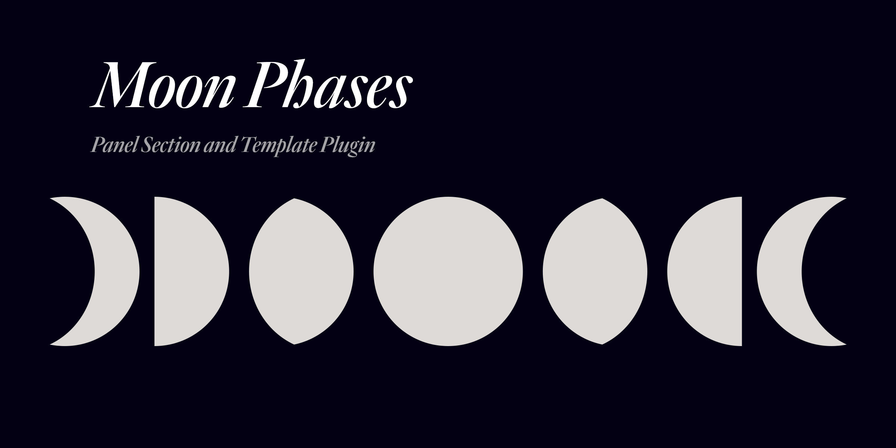

# Moon Phases for Kirby



A Kirby 5 plugin that provides moon phase information as a custom Panel Section (`type: moon-phases`) and to templates using Template Methods (`$site->moonPhases()` and helpers.


## Features

- Current moon phase name
- Number of days until the next full moon
- Number of days until the next new moon
- API-backed phase/illumination data (ipgeolocation.io astronomy endpoint)
- Configurable cache
- Customize SVG icons for moon phases (built-in preset or custom file map)


## Requirements

- [**Kirby**](https://getkirby.com/) 5.x
- ipgeolocation.io API key


## Installation

### [Kirby CLI](https://github.com/getkirby/cli)

```
kirby plugin:install scottboms/kirby-moon-phases
```

### Git Submodule

```
$ git submodule add https://github.com/scottboms/kirby-moon-phases.git site/plugins/moon-phases
```

### Copy and Paste

1. [Download](https://github.com/scottboms/kirby-moon-phases/archive/master.zip) the contents of this repository as a Zip file.
2. Rename the extracted folder to `moon-phases` and copy it into the `site/plugins/` directory in your Kirby project.


## Configuration

### Site Config

In `site/config/config.php`:

```php
<?php

return [
  'scottboms.moon-phases' => [
    'api' => [
      'provider' => 'ipgeolocation',
      'key' => 'IPGEOLOCATION_API_KEY',
      'baseUrl' => 'https://api.ipgeolocation.io/astronomy',
      'timeout' => 8,
    ],
    'location' => [
      'lat' => 40.7128,
      'lng' => -74.0060,
      'timezone' => 'America/New_York',
    ],
    'cache' => [
      'ttl' => 60, // in minutes
    ],
    'icons' => [
      'mode' => 'preset', // preset | custom
      'path' => kirby()->root('index') . '/assets/moon-icons',
      'map' => [
        'new_moon' => 'new.svg',
        'waxing_crescent' => 'waxing-crescent.svg',
        'first_quarter' => 'first-quarter.svg',
        'waxing_gibbous' => 'waxing-gibbous.svg',
        'full_moon' => 'full.svg',
        'waning_gibbous' => 'waning-gibbous.svg',
        'last_quarter' => 'last-quarter.svg',
        'waning_crescent' => 'waning-crescent.svg',
      ],
    ],
  ],
];
```

### Section
The plugin's custom Panel Section can be added to a blueprint and adopts any defined configuration options.

```yaml
sections:
  moon:
    type: moon-phases
    title: Lunar Snapshot
    showIllumination: true
    precision: 1
```

## Template Usage

You can use the following site helper methods in your templates. Use `1` or `0` to set the precision level of the values returned.

```php
<?= $site->moonPhase() ?>
<?= $site->moonPhaseLabel() ?>
<?= $site->moonIllumination(0) ?>
<?= $site->daysUntilNewMoon(1) ?>
<?= $site->daysUntilFullMoon(1) ?>
```

`$site->moonPhaseIcon()` returns an SVG string you can render in templates.


## Disclaimer

This plugin is provided "as is" with no guarantee. Use it at your own risk and always test before using it in a production environment. If you identify an issue, typo, etc, please [create a new issue](https://github.com/scottboms/kirby-moon-phases/issues/new) so I can investigate.


## License

[MIT](https://opensource.org/licenses/MIT)
